  <h1>Hola, soy Edwyn 👋</h1>
  <h3><b>IA/ML, Mid Full-stack y DevOps Engineer</b></h3>

  <picture>
    <source media="(prefers-color-scheme: dark)" srcset="https://raw.githubusercontent.com/edwyng/edwyng/output/pacman-contribution-graph-dark.svg">
    <source media="(prefers-color-scheme: light)" srcset="https://raw.githubusercontent.com/edwyng/edwyng/output/pacman-contribution-graph.svg">
    
  </picture>

 

  

  Actualmente me desempeño como desarrollador full-stack y devops engineer, mientras profundizo de manera constante en el aprendizaje automático y el deep learning como aprendiz de inteligencia artificial.
  

 

<!-- Stack Tecnológico (Tamaño aumentado a 40px para mejor visibilidad) -->

  

 

<!-- Contacto (Tamaño aumentado a 40px y proporcionado con los iconos) -->

  
  
  

